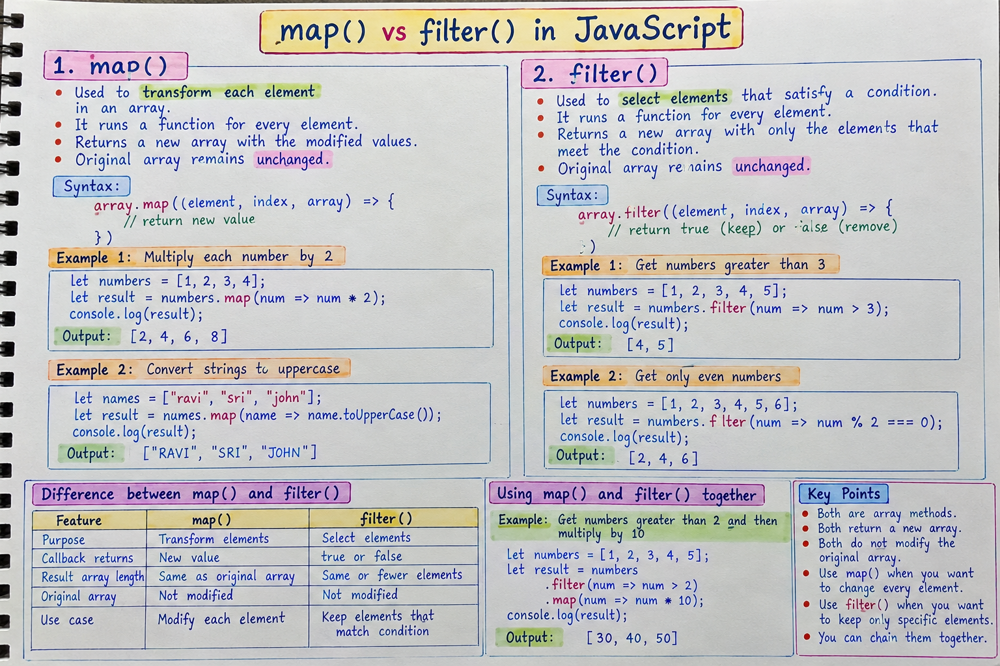

map() transforms each element and returns a new array,
map() — For Transforming Data
Runs a callback and builds a new array from the returned values.
Original array remains unchanged.
Ideal for transforming or reshaping data.

filter() keeps only elements that match a condition and returns a new array
filter() — For Selecting Items
Runs a callback and keeps only elements where the callback returns true.
Returns a new array, possibly shorter.

Use map() when you need to transform every element into something new.
Use filter() when you need to keep only certain elements based on a condition.

The filter method doesn't do the same as the map method.
The map method is used to convert each item of an array, while the filter method is used to select certain items of an array.

Array.map() transforms each element into a new value, while Array.filter() selects only the elements that meet a condition.
🌈 Array.map() — Transforming Arrays
✅ What it does
map() creates a new array by applying a function to every element of the original array.
It does not modify the original array.
The output array is always the same length as the input.
✅ Syntax
const newArray = array.map((element, index, array) => {
  return transformedValue;
});
✅ Simple Example
const numbers = [1, 2, 3];
const doubled = numbers.map(num => num * 2);

console.log(doubled); // [2, 4, 6]
✅ Real-world Example
Convert an array of objects into an array of names:
const users = [
  { name: "Asha", age: 25 },
  { name: "Ravi", age: 30 }
];

const names = users.map(user => user.name);
console.log(names); // ["Asha", "Ravi"]
✅ When to use map()
Transforming values
Extracting specific properties
Formatting data
Applying calculations to each item
🌿 Array.filter() — Selecting Elements
✅ What it does
filter() creates a new array containing only the elements that pass a test (return true).
It does not modify the original array.
The output array may be shorter than the input.
✅ Syntax
const newArray = array.filter((element, index, array) => {
  return condition; // must be true or false
});
✅ Simple Example
const numbers = [1, 2, 3, 4];
const even = numbers.filter(num => num % 2 === 0);

console.log(even); // [2, 4]
✅ Real-world Example
Filter users older than 25:
const users = [
  { name: "Asha", age: 25 },
  { name: "Ravi", age: 30 }
];

const adults = users.filter(user => user.age > 25);
console.log(adults); // [{ name: "Ravi", age: 30 }]
✅ When to use filter()
Removing unwanted items
Selecting items based on conditions
Searching within arrays
Cleaning data
🔥 map() vs filter() — Quick Comparison
Feature
map()
filter()
Purpose
Transform elements
Select elements
Output length
Same as input
Equal or smaller
Return value
New transformed array
New filtered array
Callback returns
New value
true or false
💡 Common Pattern: Using Both Together
const numbers = [1, 2, 3, 4, 5];

const doubledEvens = numbers
  .filter(num => num % 2 === 0)
  .map(num => num * 2);

console.log(doubledEvens); // [4, 8]